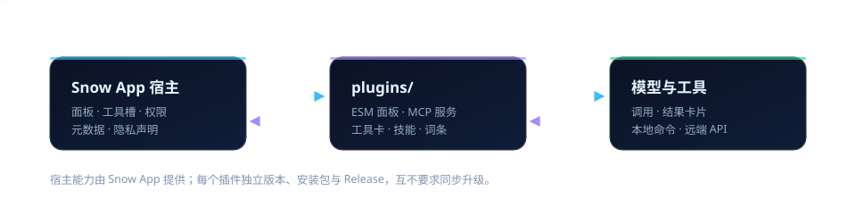

<p align="center">
  
</p>

<p align="center">
  <a href="https://github.com/BaSui01/snow-plugins/actions/workflows/ci.yml"></a>
  <a href="LICENSE"></a>
  
  
</p>

**Snow App 插件源码集合。** 六个插件分别覆盖提示词改写、GitHub 与 Docker 操作、FFmpeg 媒体处理、外部工具卡渲染和会话文件统计；每个插件拥有独立目录、唯一 ID、独立版本与 Release，可分别安装。

本仓库是插件源码仓库，不是插件市场索引。**安装或更新插件不会更新 Snow App**，插件能力受宿主版本约束，详见[宿主兼容性](#宿主兼容性)。

## 插件一览

| 插件 | ID | 版本 | 发行 | 最低宿主 |
| --- | --- | --- | --- | --- |
| [提示词优化](plugins/prompt-optimizer/README.md) | `com.snow.prompt-optimizer` | `1.4.3` | [prompt-optimizer/v1.4.3](https://github.com/BaSui01/snow-plugins/releases/tag/prompt-optimizer/v1.4.3 "提示词优化 v1.4.3 安装包") | Snow App `0.4.16`（基础功能） |
| [会话文件统计](plugins/session-file-count/README.md) | `com.snow.session-file-count` | `1.1.8` | [session-file-count/v1.1.8](https://github.com/BaSui01/snow-plugins/releases/tag/session-file-count/v1.1.8 "会话文件统计 v1.1.8 安装包") | Snow App `0.4.16`（基础功能） |
| [GitHub](plugins/github-tools/README.md) | `com.snow.github-tools` | `0.5.2` | [github-tools/v0.5.2](https://github.com/BaSui01/snow-plugins/releases/tag/github-tools/v0.5.2 "GitHub v0.5.2 安装包") | Snow App `0.5.12` |
| [Docker](plugins/docker-tools/README.md) | `com.snow.docker-tools` | `0.1.0` | [docker-tools/v0.1.0](https://github.com/BaSui01/snow-plugins/releases/tag/docker-tools/v0.1.0 "Docker v0.1.0 安装包") | Snow App `0.5.12` |
| [FFmpeg 媒体工具](plugins/ffmpeg-tools/README.md) | `com.snow.ffmpeg-tools` | `0.3.1` | [ffmpeg-tools/v0.3.1](https://github.com/BaSui01/snow-plugins/releases/tag/ffmpeg-tools/v0.3.1 "FFmpeg 媒体工具 v0.3.1 安装包") | 未声明（工具插件契约需宿主支持） |
| [工具画廊](plugins/external-tool-renderer/README.md) | `com.snow.external-tool-renderer` | `0.3.4` | [external-tool-renderer/v0.3.4](https://github.com/BaSui01/snow-plugins/releases/tag/external-tool-renderer/v0.3.4 "工具画廊 v0.3.4 安装包") | Snow App `0.4.24` + 工具卡插槽 |

发行版本、标签与安装包按插件独立管理；历史统一预发行标签 `v1.1.0-preview.1` 不是各插件当前版本的下载入口。

## 能力概览

- **提示词优化**：在面板配置优化规则、上下文与模型服务，从输入栏魔杖改写草稿；支持的宿主可经右键或更多菜单执行「本次检索项目代码并优化」，并支持安全回填与还原。**绝不自动发送**。渠道模型下拉读取所选服务的全量模型清单，旧宿主自动降级。
- **会话文件统计**：在每次任务结束回复下方展示该任务及子代理的独立文件数与清单，普通点击内联展开左右双栏 diff，保留历史卡片；不宣称完整审计，没有记录不等于没有修改。
- **GitHub**：41 个工具与结果卡片，覆盖仓库、议题、提交、PR、文件、代码与 Actions 搜索，新增讨论、通知、部署与检查运行、组织与团队、Gist、软件包；支持 GraphQL、评论、审查、Revert PR、Release 资产与受控远端写操作，并随包提供 `github-workflow` 技能。
- **Docker**：通过本机 `docker` CLI 查看和操作容器、镜像与 Compose 项目，15 个工具覆盖列表、inspect、日志、资源、启停删、exec 与镜像拉取。
- **FFmpeg 媒体工具**：在本机以子进程调用 ffmpeg / ffprobe，完成探测分析、转码压缩、剪辑抽帧、GIF/WebP、波形频谱、特效调色、字幕、拼接、HLS/DASH 打包、推流录屏与参数直通；默认不联网、不上传媒体。
- **工具画廊**：为 Anysearch、DBX、Firecrawl、Chrome DevTools、Playwright、Context7、GitHub、Exa、Brave、Tavily、Perplexity、Parallel、SerpApi、Kagi、Linkup、SearXNG、Jina、DuckDuckGo、Supabase、Postman、Linear、Sentry、GitLab、Docker、Kubernetes、Notion 共 26 类外部 MCP 工具提供统一参数摘要、表格与内容块卡片。

## 安装

1. 从上表选择插件的 Release，下载对应压缩包并解压；也可以下载或克隆本仓库。
2. 在 Snow App 插件管理页点击「从目录安装」。
3. 选择直接包含 `plugin.json` 的目录，例如 `plugins/github-tools`，不要选择仓库根目录。
4. 确认插件已启用，并按该插件 README 验收功能。

重复安装同一标识会替换已安装副本，并保留启用状态和已保存偏好。修改下载的源码不会自动更新已安装副本，更新时需重新安装相应目录。

## 宿主兼容性

<p align="center">
  
</p>

- 插件基础能力通过 [Snow App PR #179](https://github.com/MayDay-wpf/snow-app/pull/179 "两个插件基础能力的配套宿主改动已合并") 合并并进入正式版本 **v0.4.16**；v0.4.15 不包含这些能力。
- GitHub 与 Docker 插件声明最低宿主 **`0.5.12`**；低于该版本不保证可安装或可用。
- 工具画廊需要提供工具卡插槽（`ui.toolCallRendererVersion === 1`）的桌面构建，声明最低 **`0.4.24`**；该插槽已随上游 [PR #201](https://github.com/MayDay-wpf/snow-app/pull/201 "插件工具调用渲染插槽贡献已合并") 合入 `main`，尚未随正式标签发布。宿主已配套扩容支持最多 64 项渲染器贡献，mobile 未迁移。
- 提示词优化的渠道全量模型下拉需要宿主 `apiModels` 元数据域；项目代码库增强、输入栏菜单、来源预览等另需配套宿主构建与显式授权，旧宿主明确降级。当前运行的宿主缺少对应能力时，这些功能保持不可用，不以旧接口伪造。
- 会话文件统计的独立任务历史、内联 diff 与修饰键文件导航需要配套 footer 能力；**Snow App v0.4.16 的 footer 没有 `write` API**，市场最低版本仍为 `0.4.16`，不要将基础安装门槛等同于这些增强能力已兼容。
- FFmpeg 未声明 `minAppVersion`：工具插件契约已存在于宿主源码，但尚未确认任何已发布宿主版本可用。
- 本地开发源码能力、已发布宿主能力与已完成 UI 验收的能力需分开看待；静态校验通过不等于真实交互验收通过。

## 开发与校验

每个插件独立构建，不依赖相邻宿主仓库，均提供 `build` 与 `check`：

```powershell
cd plugins/github-tools
npm ci
npm run build
npm run check
```

提交前按改动范围运行仓库静态校验：

```powershell
python scripts/release.py validate
```

TypeScript 源码编译为插件运行所需的 JS；`index.js`、`footer.js` 等交付文件由各自 `npm run build` 生成，不要直接手改。禁止新增测试文件；现有测试如需修改，先说明影响。

## 发布

插件标签格式为 `<slug>/v<version>`，例如 `github-tools/v0.5.2`、`prompt-optimizer/v1.4.3`。推送标签会触发 [独立插件发布工作流](.github/workflows/release.yml)：

1. 校验标签形状与 `plugin.json` 版本一致；
2. 只打包该插件并生成 `SHA256SUMS.txt`；
3. 创建 GitHub Release；稳定版本还会向市场仓库提交更新 PR。

代码提交与标签必须同时推送，只推代码不会发版。完整门禁、市场 PR 冲突处理与回滚边界见 [RELEASING.md](RELEASING.md)。

## 市场状态

市场条目由独立 PR 维护：截至 2026-10-07 的只读核实结果，历史插件条目请求已合并，后续更新请求仍在审核。市场收录不代表所有宿主功能已经验证；Release 已发布也不等于市场更新已合并。

## 贡献与安全

- [贡献指南](CONTRIBUTING.md)：目录、ID、版本约定、验证要求与协作边界。
- [发布指南](RELEASING.md)：独立标签、安装包、Release 与市场更新流程；发布需明确授权。
- [安全政策](SECURITY.md)：脱敏报告、凭据泄露处置与私密联系边界。
- [报告问题](https://github.com/BaSui01/snow-plugins/issues/new?template=bug_report.yml "填写插件和宿主版本及脱敏复现资料") · [提出功能建议](https://github.com/BaSui01/snow-plugins/issues/new?template=feature_request.yml "描述需求与宿主兼容性边界")。

## 来源与许可证

工具画廊插件迁移自 Snow App 桌面开发源码的 Anysearch / DBX 组件、专属词条和样式，保留原 MIT 版权，详见[来源声明](plugins/external-tool-renderer/NOTICE)和[独立许可证](plugins/external-tool-renderer/LICENSE)。

提示词优化与会话文件统计最早复制自插件市场仓库提交 `14f6cd398ab871a6c40cfa76940bef40bd8a6ab7` 中的两个插件目录，原提交历史保留；本仓库从独立初始化提交开始，未迁入商店的其他文件或历史。

沿用原有 MIT 许可证与版权声明，详见 [LICENSE](LICENSE) 和[提示词优化许可证](plugins/prompt-optimizer/LICENSE)。
